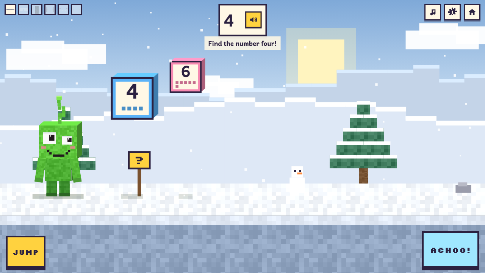

# Doodle Builders

A learning game for children aged 2 to 5: answer phonics and number questions to build outposts, with heroes drawn from children's own doodles.

**[Play it](https://dao-wolf.github.io/doodle-builders/)** in a web browser on a computer, phone or tablet.

## What's in the game

- **Bob's Outpost**, the first adventure. Play as Bob (sneezes Nibblers away) or Mr Henry (trumps them away), collect the pieces of an outpost on a journey, keep the Nibblers off them, then build it. Four outposts: Hilltop Hut, Treehouse, Lighthouse and Snow Castle.
- **Letters and sounds** in the Little Wandle Letters and Sounds Revised Reception order (Autumn 1 to Spring 1).
- **Numbers**: find the number (1 to 5 or 1 to 10) and count gems.
- **Gentle help**: everything is spoken as well as shown, and a wrong answer gets a hint and another go.
- **Your own voice**: record the sounds in the voice studio and the game uses your voice first.
- **Seasonal looks**: Halloween (15 October to 3 November) and Christmas (1 December to 6 January) dress up the lands, outposts and heroes. Children can switch the look off and on with a picture button on the start screen.

## More

- [For grown-ups](docs/grown-ups.md): the settings, seasonal themes, and recording your own voice.
- [Developing](docs/developing.md): running it on your computer, how the code is laid out, testing and code quality.

## Credits

- Bob and Mr Henry come from a child's sketch-pad drawings.
- Built-in voice: **Jenny (Dioco)**, made with [Piper](https://github.com/OHF-Voice/piper1-gpl). The Jenny dataset licence requires the attribution "Jenny (Dioco)" wherever the voice is used, and allows commercial use: <https://github.com/dioco-group/jenny-tts-dataset>. Piper (GPL-3.0) is used only by the voice scripts in `tools/voice/`; the game doesn't include it.
- Fonts: Andika and Silkscreen (SIL Open Font License). They load from Google Fonts' servers until they are self-hosted.
- Not affiliated with or endorsed by Little Wandle Letters and Sounds Revised. The teaching order follows their published Reception overview; no Little Wandle materials, audio or images are included.
- A licence for the code is still being chosen, so there is no `LICENSE` file yet.
