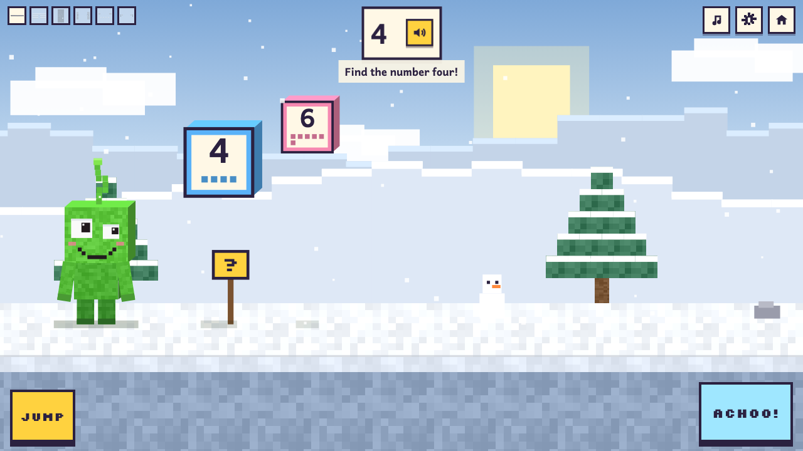

# Doodle Builders

A learning game for children aged 2 to 5: answer phonics and number questions to build outposts, with heroes drawn from children's own doodles.

**[Play it](https://dao-wolf.github.io/doodle-builders/)** in a web browser on a computer, phone or tablet.

## What's in the game

- **Bob's Outpost**, the first adventure. Play as Bob (sneezes Nibblers away), Mr Henry (trumps them away), Dragon Fly (a floating robot dragon that breathes red fire at them) or Lava (a chicken that spews warm, friendly lava, in sunny or lagoon colours), collect the pieces of an outpost on a journey, keep the Nibblers off them, then build it. Four outposts: Hilltop Hut, Treehouse, Lighthouse and Snow Castle.
- **Letters** in the Little Wandle Letters and Sounds Revised Reception order (Autumn 1 to Spring 1).
- **Numbers**: find the number (1 to 5 or 1 to 10) and count gems.
- **Gentle help**: everything is spoken as well as shown, and a wrong answer gets a hint and another go.
- **The den**: a meadow where a child looks after their hero. Tap them, feed them, play ball and dress them up in any costume; Lava can change colour. There are no scores and nothing to get wrong. See [The den](docs/den.md).
- **Your own voice**: record letter sounds, numbers and lines in the voice studio and the game uses your voice first. Letter sounds only play if you record them, because the built-in voices can't say them properly.
- **Seasonal looks**: Halloween (15 October to 3 November), Christmas (4 November to 6 January) and Easter (two weeks before Easter Sunday to a week after it) dress up the lands, outposts and heroes. Children can switch the look off and on with a picture button on the start screen.

## More

- [For grown-ups](docs/grown-ups.md): the settings, seasonal themes, and recording your own voice.
- [The den](docs/den.md): what children can do there, the rules it follows, and the backlog.
- [Developing](docs/developing.md): running it on your computer, how the code is laid out, testing and code quality.

## Credits

- Bob, Mr Henry and Lava come from a child's drawings. Dragon Fly comes from a model built from toy bricks.
- Built-in voice: **Jenny (Dioco)**, made with [Piper](https://github.com/OHF-Voice/piper1-gpl). The Jenny dataset licence requires the attribution "Jenny (Dioco)" wherever the voice is used, and allows commercial use: <https://github.com/dioco-group/jenny-tts-dataset>. Piper (GPL-3.0) is used only by the voice scripts in `tools/voice/`; the game doesn't include it.
- Fonts: Andika and Silkscreen (SIL Open Font License). They load from Google Fonts' servers until they are self-hosted.
- Not affiliated with or endorsed by Little Wandle Letters and Sounds Revised. The teaching order follows their published Reception overview; no Little Wandle materials, audio or images are included.
- A licence for the code is still being chosen, so there is no `LICENSE` file yet.
