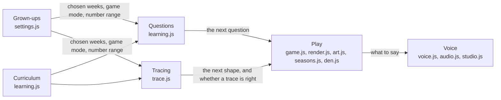

# The learning domain

What the game teaches and what it asks, in the words the code, the tests and these docs share. Back to [Developing](developing.md).

The rules live in `js/learning.js` (what to ask) and `js/trace.js` (what to trace in the hero's house). Neither touches the page, the canvas or sound, so the unit tests in `tests/` run them in Node. The rest of the game asks them for the next question or the next shape and shows it.

## Words we use

| Word | Meaning | In the code |
|---|---|---|
| Grapheme | A letter, or letters, that write one sound: `s`, `ck`, `igh` | `G` |
| Week | The graphemes Little Wandle teaches in one week of Reception | `WEEKS`, ids like `Autumn 1-0` |
| Term | Autumn 1, Autumn 2 or Spring 1 | `TERMS` |
| Chosen weeks | The weeks a grown-up ticks in the settings (all of Autumn 1 to start with) | `S.weeks`, `chosenGraphemes()` |
| Taught so far | Every week up to the last chosen one, ticked or not | `taughtUpTo()` |
| Clash | Two graphemes a child must never choose between: they look alike (b, d, p) or write the same sound (c, k, ck) | `LOOKALIKE`, `SAME`, `clashes()` |
| Game mode | abc letters, 123 numbers or a1 both | `S.mode`: `literacy`, `numeracy`, `both` |
| Plan | The order of question types in a game mode | `PLANS`, `questionType()` |
| Question | What the card asks: find a letter or sound (`match`), find a number (`number`), or count gems (`count`) | `round.type` |
| Target | The right answer | `round.target` (`round.n` when counting) |
| Other answers | The two wrong answers shown with the target | `otherGraphemes()`, `numberQuestion()` |
| Recent | The last few graphemes asked, which aren't asked again yet | `recent`, `pickGrapheme()` |
| Number range | Numbers 1 to 5, or 1 to 10 | `S.nums` |
| Hero's house | The meadow where a child feeds their hero by tracing: "Lava's house", "Bob's house", "Mr Henry's house", "Dragon Fly's house". Called the den until 10 Nov 2026, and still `den` in the code | `js/den.js`, `den`, `#den*` |
| Trace item | A letter or a number a child can be asked to trace: a single letter, never a digraph, or a number 1 to 10 | `{ kind: 'letter', id }`, `{ kind: 'number', n }` |
| Shape | The path of a trace item, scaled so its longest side is 1 | `traceShape()` |
| Stroke | One touch of a shape: the finger goes down, follows the path and lifts. A t has two, an x has two, a k has three | `shape.strokes` |
| Start dot | Where a stroke begins; the green dot | `traceStart()` |
| Tolerance | How far a finger may stray from the path and still count | `TRACE_RULES.tolerance` |
| Trace | The state of one child's attempt at a shape: which stroke, how far along, whether the finger is on the path | `newTrace()`, `traceDown()`, `traceMove()`, `traceUp()` |
| Snack bar | Three parts, one filled by each right trace. It empties only after the hero's happy dance | `newBar()`, `addSnack()`, `danced()` |

## The rules

Each rule has an outside-in test in `tests/acceptance/questions.test.js`, written in these words, and unit tests in `tests/unit/`.

- **A letter question** asks for a grapheme from the chosen weeks, or from the first week (s, a, t, p) if none is chosen. It isn't one of the last four asked, or of the last few when fewer than five are chosen.
- **Its answers** are the target and two others. No two of the three clash. The others come from the chosen weeks first, then the weeks taught so far, then any grapheme.
- **A number question** asks for a number in the number range, and offers two other numbers in that range. Earlier versions could offer 6 when the range was 1 to 5.
- **A counting question** asks for 2 to 5 gems with numbers to 5, or 3 to 7 with numbers to 10.
- **The game mode** sets the order: letters only; a number then counting; or a letter, a number, then counting. A mode it doesn't know plays as both.

## Tracing

Each rule has unit tests in `tests/unit/trace.test.js`, written in these words, before the code.

- **A shape** exists for each single letter in the curriculum and each number 1 to 10, and for nothing else: no digraph (`sh`, `igh`, `ck`) and no number outside 1 to 10. A 10 is a 1 and then a 0. Letters are lower case, formed the way UK phonics lessons teach them. Every shape has at most four strokes.
- **What to trace** is the single letters of the chosen weeks, or of the weeks taught so far when the chosen weeks hold only digraphs, and numbers from 1 to the number range. The game mode decides: letters only, numbers only, or both, which take turns. An item isn't repeated within a few of its own kind.
- **A trace is right** when the finger starts near the start dot, follows each stroke in order within the tolerance, and covers at least 85 per cent of each stroke. It is right for a wobbly finger, a fast finger and a finger that stops a little short. It is wrong for a scribble, half a stroke, a trace from the wrong end, strokes in the wrong order, and a different shape.
- **Going off the path loses nothing.** The trace says "off" once when the finger leaves the path, keeps all progress, and carries on when the finger comes back or lifts and tries again. A touch that lands away from the start counts for nothing until the finger lifts.
- **The snack bar** has three parts. Each right trace fills one, and a fourth doesn't overfill it. Nothing but the hero's happy dance empties it.

How it looks and what a child does is in [The hero's house](den.md). The level's build step could use the same rules later; nothing in `js/game.js` does yet.

## The areas

| Area | What it decides | Files | Tested by |
|---|---|---|---|
| Curriculum | The graphemes, the weeks and which graphemes clash | `js/learning.js` | unit tests |
| Questions | What to ask next, and which answers to offer | `js/learning.js` | unit tests |
| Tracing | Which letters and numbers to trace, their shapes, whether a trace is right, and the snack bar | `js/trace.js` | unit tests |
| Play | The journey, Nibblers, building, drawing, seasons and the hero's house | `js/game.js`, `js/render.js`, `js/art.js`, `js/seasons.js`, `js/calendar.js` (season dates, unit tests), `js/den.js`, `LEVELS` and `THEMES` in `js/content.js` | playtests, `calendar.test.js` |
| Voice | Spoken lines, own recordings and the voice studio | `js/voice.js`, `js/audio.js`, `js/studio.js`, `TEXT` in `js/content.js` | playtests |
| Grown-ups | The settings and the grown-ups check | `js/settings.js` | playtests |

Curriculum and Questions use nothing from the other areas. Tracing uses only the Curriculum. The other areas still share one global scope (see [Developing](developing.md#project-layout)), so moving another area's rules into a page-free file, with unit tests, is a slice of its own.

## Changing a rule

1. Write or change the outside test in `tests/acceptance/`, in the words above, and watch it fail.
2. Write the unit test for the piece that changes, and watch it fail.
3. Change `js/learning.js` (or `js/trace.js` for a tracing rule) until both pass.
4. Run the unit tests and the playtests: `node --test "tests/**/*.test.js"`, then the playtests in [Developing](developing.md#testing).
