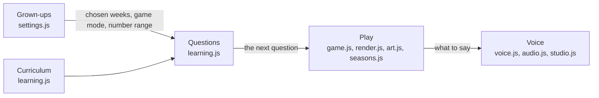

# The learning domain

What the game teaches and what it asks, in the words the code, the tests and these docs share. Back to [Developing](developing.md).

The rules live in `js/learning.js`. It never touches the page, the canvas or sound, so the unit tests in `tests/` run it in Node. The rest of the game asks it for the next question and shows it.

## Words we use

| Word | Meaning | In the code |
|---|---|---|
| Grapheme | A letter, or letters, that write one sound: `s`, `ck`, `igh` | `G` |
| Week | The graphemes Little Wandle teaches in one week of Reception | `WEEKS`, ids like `Autumn 1-0` |
| Term | Autumn 1, Autumn 2 or Spring 1 | `TERMS` |
| Chosen weeks | The weeks a grown-up ticks in the settings (all of Autumn 1 to start with) | `S.weeks`, `chosenGraphemes()` |
| Taught so far | Every week up to the last chosen one, ticked or not | `taughtUpTo()` |
| Clash | Two graphemes a child must never choose between: they look alike (b, d, p) or write the same sound (c, k, ck) | `LOOKALIKE`, `SAME`, `clashes()` |
| Game mode | abc letters, 123 numbers or a1 both | `S.mode`: `literacy`, `numeracy`, `both` |
| Plan | The order of question types in a game mode | `PLANS`, `questionType()` |
| Question | What the card asks: find a letter or sound (`match`), find a number (`number`), or count gems (`count`) | `round.type` |
| Target | The right answer | `round.target` (`round.n` when counting) |
| Other answers | The two wrong answers shown with the target | `otherGraphemes()`, `numberQuestion()` |
| Recent | The last few graphemes asked, which aren't asked again yet | `recent`, `pickGrapheme()` |
| Number range | Numbers 1 to 5, or 1 to 10 | `S.nums` |

## The rules

Each rule has an outside-in test in `tests/acceptance/questions.test.js`, written in these words, and unit tests in `tests/unit/`.

- **A letter question** asks for a grapheme from the chosen weeks, or from the first week (s, a, t, p) if none is chosen. It isn't one of the last four asked, or of the last few when fewer than five are chosen.
- **Its answers** are the target and two others. No two of the three clash. The others come from the chosen weeks first, then the weeks taught so far, then any grapheme.
- **A number question** asks for a number in the number range, and offers two other numbers in that range. Earlier versions could offer 6 when the range was 1 to 5.
- **A counting question** asks for 2 to 5 gems with numbers to 5, or 3 to 7 with numbers to 10.
- **The game mode** sets the order: letters only; a number then counting; or a letter, a number, then counting. A mode it doesn't know plays as both.

## The five areas

| Area | What it decides | Files | Tested by |
|---|---|---|---|
| Curriculum | The graphemes, the weeks and which graphemes clash | `js/learning.js` | unit tests |
| Questions | What to ask next, and which answers to offer | `js/learning.js` | unit tests |
| Play | The journey, Nibblers, building, drawing and seasons | `js/game.js`, `js/render.js`, `js/art.js`, `js/seasons.js`, `LEVELS` and `THEMES` in `js/content.js` | playtests |
| Voice | Spoken lines, own recordings and the voice studio | `js/voice.js`, `js/audio.js`, `js/studio.js`, `TEXT` in `js/content.js` | playtests |
| Grown-ups | The settings and the grown-ups check | `js/settings.js` | playtests |

Curriculum and Questions use nothing from the other areas. The other areas still share one global scope (see [Developing](developing.md#project-layout)), so moving another area's rules into a page-free file, with unit tests, is a slice of its own.

## Changing a rule

1. Write or change the outside test in `tests/acceptance/`, in the words above, and watch it fail.
2. Write the unit test for the piece that changes, and watch it fail.
3. Change `js/learning.js` until both pass.
4. Run the unit tests and the playtests: `node --test "tests/**/*.test.js"`, then the playtests in [Developing](developing.md#testing).
