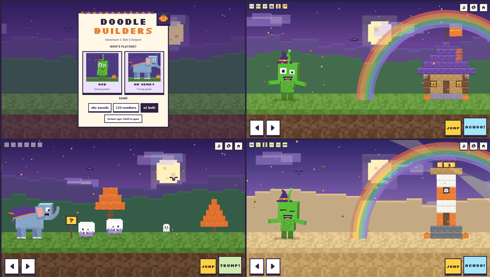
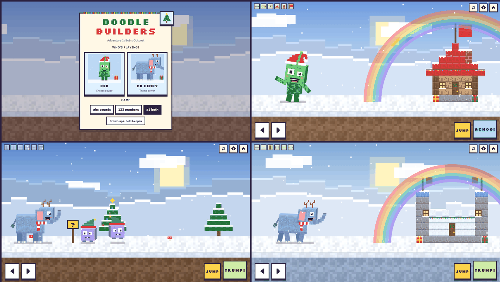
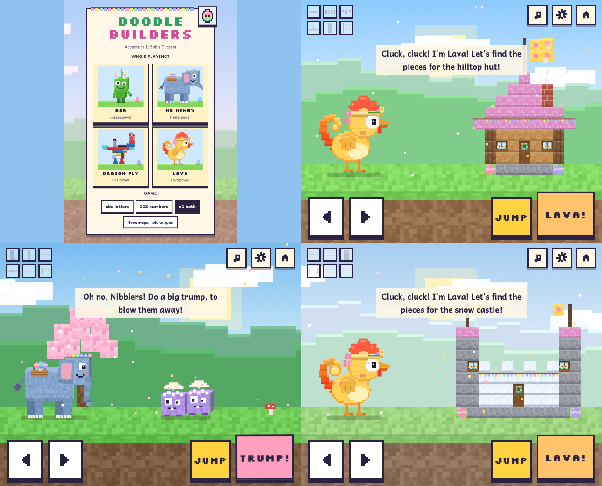

# For grown-ups

How to change the game's settings, what the seasonal themes do, and how to record your own voice. Back to the [README](../README.md).

## Settings

On the start screen, press and hold **Grown-ups**. During a game, press and hold the **gear** button (the game pauses). Then type the number shown in words: "forty-seven" is 4 then 7. Young children can't read it and it is never spoken, so this keeps them out of the settings. Each time brings a new number, and three wrong answers in a row lock it for a minute. Settings are saved on the device:

| Setting | Options |
|---|---|
| Game | Letters, Numbers, Both |
| Movement | I steer (arrows), Walks by itself |
| Difficulty | Easy, Medium, Hard |
| Letters to practise | Little Wandle Reception weeks to practise |
| Letters shown as | lowercase, UPPERCASE, Both |
| Numbers | 1 to 5, 1 to 10 |
| Voice | Natural (Jenny) or Device voice, plus "Use my own recordings first" |
| Seasonal themes | Automatic, Halloween, Christmas, Easter, Off |
| Outposts | Unlock all, or start again from outpost 1 |

**Game**, **Letters to practise** and **Numbers** also choose what children trace in the hero's house, where tracing a letter or a number feeds their hero (see [The hero's house](den.md)). They trace single letters only, in lower case, whatever **Letters shown as** says: a week made only of two-letter sounds such as `sh` falls back to the single letters taught so far.

## Seasonal themes

The game dresses up for the seasons, then goes back to normal:

| Season | Shown | What changes |
|---|---|---|
| Halloween | 15 October to 3 November | Dusk sky with a moon, stars and friendly bats; falling leaves; pumpkins and cute ghosts; pumpkin lanterns, cobwebs and a ghost at the lighthouse window; Bob in a witch hat, Mr Henry in a cape, Dragon Fly with a pumpkin bucket and its pilot in a witch hat, Nibblers in ghost sheets |
| Christmas | 4 November to 6 January | Snow; Christmas trees, presents and snowmen in scarves; snowy roofs, wreaths and fairy lights on the outposts; Bob in a Santa hat, Mr Henry in antlers and a scarf, Dragon Fly in fairy lights and its pilot in a Santa hat, Nibblers in elf hats |
| Easter | Two weeks before Easter Sunday to a week after it (14 March to 4 April in 2027, 2 to 23 April in 2028) | Pastel meadow with pink blossom trees, painted eggs, tulips, hopping bunnies and chicks, and drifting petals; the snow has melted; pink roofs, egg blocks, bunting and flower boxes on the outposts; Bob in bunny ears, Mr Henry in a flower crown with an egg basket, Dragon Fly with an egg basket and its pilot in bunny ears, Lava in an Easter bonnet, Nibblers in cracked eggshells |

While a season is on, a big picture button (a pumpkin, a Christmas tree or an egg) sits on the corner of the start screen, so children can switch the look off and back on without reading. It starts on each time a season begins. In the settings, **Seasonal themes** chooses how the look is picked:

| Option | What it does |
|---|---|
| Automatic | Halloween, Christmas and Easter on the dates above, the normal look the rest of the year |
| Halloween | The Halloween look whatever the date |
| Christmas | The Christmas look whatever the date |
| Easter | The Easter look whatever the date |
| Off | No seasonal look, no picture button, and no costumes: heroes wear nothing in the [hero's house](den.md) or in levels, and the house's costume buttons are hidden. A costume a child picked stays saved and comes back when you change this setting. Lava's colours are not costumes, so they stay |

 The outposts keep the same shapes and pieces, so the game plays the same.

To see a look on another day, add `?season=halloween`, `?season=christmas`, `?season=easter` or `?season=none` to the address, or pretend it is another date with `?date=2026-12-24`.

## Record your own voice

Text-to-speech cannot say letter sounds properly, so the built-in voices don't say them: children see the letter and hear "Find". They hear the letter's sound only if you record it, so the best voice for teaching is yours.

1. Open the game from GitHub Pages or `localhost` (see [Developing](developing.md#run-it-on-your-computer)). The microphone is blocked inside the Claude app viewer.
2. On the start screen, **press and hold "Grown-ups"**, type the number shown in words, then press **Open voice studio**.
3. Pick a clip and press **RECORD**. Recording stops by itself when you stop talking; silence is trimmed and the volume is evened out. Press **Play** to check it, then **Next**.
4. Start with the **Sounds** tab: they only play if you record them, and they are the ones children copy. Words, Numbers and Bob's lines are optional; anything else you don't record is said by Jenny.
5. Press **Export voice pack** to save `my-voice.json`, put it in the `voice/` folder, then commit and push. Your voice now plays on every device that opens the game.

You can also **Upload a file** for any clip (for example a voice memo recorded on your phone) and **Import voice pack** to load a pack onto another device. Recordings made in the studio are kept in that browser until you export them.

Tips for pure sounds: say `s`, `m`, `f` and other stretchy sounds as a held "sss" or "mmm"; keep bouncy sounds like `t`, `p`, `b` short with no "uh" after them. Little Wandle's free "How to say the sounds" videos for parents show each one: <https://www.littlewandle.org.uk/resources/for-parents/>.
