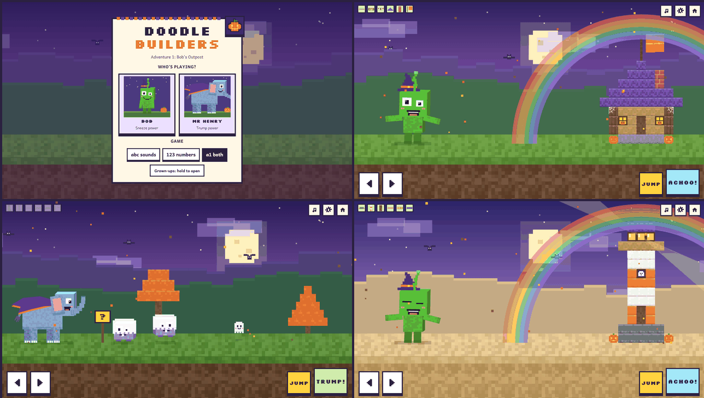
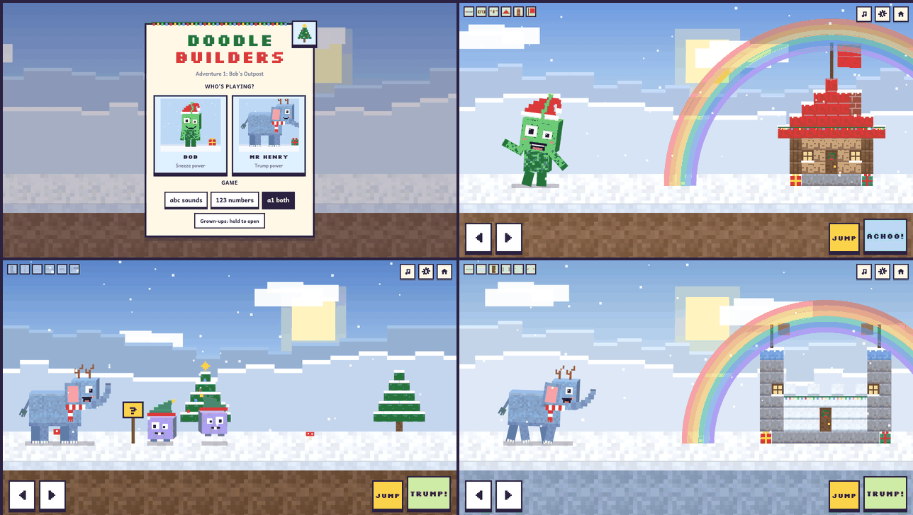

# For grown-ups

How to change the game's settings, what the seasonal themes do, and how to record your own voice. Back to the [README](../README.md).

## Settings

On the start screen, press and hold **Grown-ups**. During a game, press and hold the **gear** button (the game pauses). Settings are saved on the device:

| Setting | Options |
|---|---|
| Game | Letters & sounds, Numbers, Both |
| Movement | I steer (arrows), Walks by itself |
| Difficulty | Easy, Medium, Hard |
| Phonics sounds | Little Wandle Reception weeks to practise |
| Letters shown as | lowercase, UPPERCASE, Both |
| Numbers | 1 to 5, 1 to 10 |
| Voice | Natural (Jenny) or Device voice, plus "Use my own recordings first" |
| Seasonal themes | Automatic, Halloween, Christmas, Off |
| Outposts | Unlock all, or start again from outpost 1 |

## Seasonal themes

The game dresses up for the seasons, then goes back to normal:

| Season | Shown | What changes |
|---|---|---|
| Halloween | 15 October to 3 November | Dusk sky with a moon, stars and friendly bats; falling leaves; pumpkins and cute ghosts; pumpkin lanterns, cobwebs and a ghost at the lighthouse window; Bob in a witch hat, Mr Henry in a cape, Nibblers in ghost sheets |
| Christmas | 4 November to 6 January | Snow; Christmas trees, presents and snowmen in scarves; snowy roofs, wreaths and fairy lights on the outposts; Bob in a Santa hat, Mr Henry in antlers and a scarf, Nibblers in elf hats |

While a season is on, a big picture button (a pumpkin or a Christmas tree) sits on the corner of the start screen, so children can switch the look off and back on without reading. It starts on each time a season begins. In the settings, **Seasonal themes** chooses how the look is picked:

| Option | What it does |
|---|---|
| Automatic | Halloween and Christmas on the dates above, the normal look the rest of the year |
| Halloween | The Halloween look whatever the date |
| Christmas | The Christmas look whatever the date |
| Off | No seasonal look and no picture button |

 The outposts keep the same shapes and pieces, so the game plays the same.

To see a look on another day, add `?season=halloween`, `?season=christmas` or `?season=none` to the address, or pretend it is another date with `?date=2026-12-24`.

## Record your own voice

Text-to-speech cannot say pure phonics sounds properly, so the best voice for teaching is yours.

1. Open the game from GitHub Pages or `localhost` (see [Developing](developing.md#run-it-on-your-computer)). The microphone is blocked inside the Claude app viewer.
2. On the start screen, **press and hold "Grown-ups"**, then **Open voice studio**.
3. Pick a clip and press **RECORD**. Recording stops by itself when you stop talking; silence is trimmed and the volume is evened out. Press **Play** to check it, then **Next**.
4. Start with the **Sounds** tab: they are the ones children copy. Words, Numbers and Bob's lines are optional; anything you don't record is said by Jenny.
5. Press **Export voice pack** to save `my-voice.json`, put it in the `voice/` folder, then commit and push. Your voice now plays on every device that opens the game.

You can also **Upload a file** for any clip (for example a voice memo recorded on your phone) and **Import voice pack** to load a pack onto another device. Recordings made in the studio are kept in that browser until you export them.

Tips for pure sounds: say `s`, `m`, `f` and other stretchy sounds as a held "sss" or "mmm"; keep bouncy sounds like `t`, `p`, `b` short with no "uh" after them. Little Wandle's free "How to say the sounds" videos for parents show each one: <https://www.littlewandle.org.uk/resources/for-parents/>.
